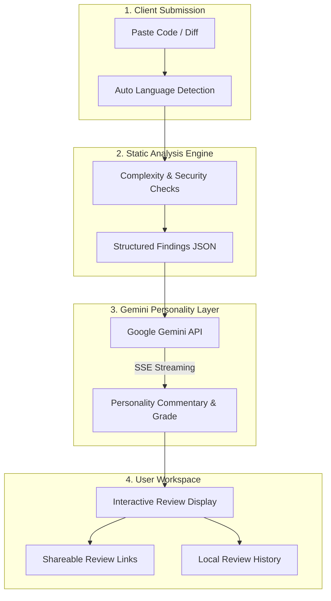

<div align="center">

# 🔥 Can You Code

### AI-Powered Code Reviewer with Personality & Real Static Analysis

[](https://python.org)
[](https://fastapi.tiangolo.com)
[](https://react.dev)
[](https://www.typescriptlang.org)
[](https://tailwindcss.com)
[](https://vitejs.dev)
[](LICENSE)

<p align="center">
  <b>Paste your code. Pick a personality. Get roasted (or cheered on) by AI with real static analysis.</b>
</p>

</div>

---

## 💡 The Problem & The Solution

**The Problem**:
Standard code linters are boring and dry, and generic AI chat prompts require tedious boilerplate just to get a quick code review. Developers want immediate, insightful, and entertaining feedback that catches real bugs without losing character.

**The Solution**:
**Can You Code** combines real static analysis with human-style AI personality reviews:
- **Automatic Language Detection**: Paste Python, Java, C, C++, JavaScript, or TypeScript — the engine automatically detects the language.
- **12 Distinct Reviewer Personalities**: Choose your preferred roast or mentoring style, from *Brutal Senior Engineer* and *Gordon Ramsay But For Code* to *Encouraging Mentor*.
- **Real-Time Streaming Feedback**: Streamed progressive responses via Server-Sent Events (SSE).
- **Luxury Aesthetic Design**: Warm, muted, earthy tones with seamless dark/light mode switching.
- **Shareable Review Links**: Generate permanent public links for any code critique.

---

## 🏛️ System Architecture



---

## ✨ Key Features

1. **Multi-Language Static Analysis**: Inspects cyclomatic complexity, magic numbers, secrets, bare exceptions, unused imports, and dead code.
2. **12 Reviewer Personalities**: Switch between brutal roasts, passive-aggressive tech leads, chaos goblins, and encouraging mentors instantly.
3. **Random & Roast**: Quick dice rolling animation that automatically picks a random personality and triggers the review.
4. **Dark & Light Luxury Themes**: Obsidian `#1C1B19` & Champagne `#C6AE83` dark palette; Ivory `#F5F0E8` & Mocha `#80664D` light palette.
5. **Shareable Reviews**: Save and share critique links with custom share tokens.

---

## 💻 Tech Stack

| Component | Technology | Rationale |
|---|---|---|
| **Frontend** | React 19, TypeScript, Vite | Fast HMR, type safety, modern component architecture |
| **Styling** | Tailwind CSS + CSS Variables | Quiet luxury aesthetic with instant dark/light flipping |
| **Icons** | Lucide React / Inline SVGs | Crisp vector icons with absolute symmetry |
| **Backend** | Python 3.12, FastAPI | High-performance asynchronous API framework |
| **Database** | SQLAlchemy (SQLite) | Lightweight relational persistence for review history |
| **AI Layer** | Google GenerativeAI (`gemini-1.5-flash`) | Fast, creative, and cost-effective streaming responses |

---

## ⚡ Quickstart Guide

### Prerequisites
- **Python 3.10+** (Python 3.12 recommended)
- **Node.js 18+** & **npm**

---

### 1. Backend Setup
```bash
cd backend
python -m venv venv

# Activate virtual environment
# Windows (PowerShell):
venv\Scripts\activate
# Linux / macOS:
source venv/bin/activate

# Install dependencies
pip install -r requirements.txt

# Configure environment
cp .env.example .env
# Add your GEMINI_API_KEY to .env

# Start FastAPI server on port 8000
uvicorn main:app --reload --port 8000
```

### 2. Frontend Setup
```bash
# Open a new terminal and navigate to frontend
cd frontend

# Install dependencies
npm install

# Start Vite dev server on port 5173
npm run dev
```
> Open `http://localhost:5173` in your browser.

---

## 📁 Repository Structure

```
CanYouCode/
├── backend/
│   ├── app/
│   │   ├── analysis/         # Static analysis checks (complexity, bugs, style)
│   │   ├── api/              # FastAPI endpoints
│   │   ├── models/           # SQLAlchemy database models
│   │   ├── personality/      # Gemini prompts and personality configs
│   │   └── schemas/          # Pydantic validation schemas
│   ├── main.py               # FastAPI application entrypoint
│   └── requirements.txt      # Python dependencies
├── frontend/
│   ├── src/
│   │   ├── components/       # Code input, personality picker, review display, header, footer
│   │   ├── hooks/            # Streaming review and history hooks
│   │   ├── lib/              # Constants, themes, and utility functions
│   │   ├── pages/            # HomePage and ReviewPage
│   │   ├── App.tsx           # Router and layout wrapper
│   │   └── main.tsx          # Frontend entrypoint
│   ├── package.json          # Node dependencies
│   ├── tailwind.config.js    # Tailwind configuration
│   └── vite.config.ts        # Vite build configuration
└── README.md                 # Project documentation
